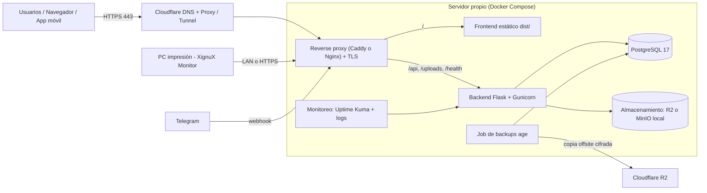
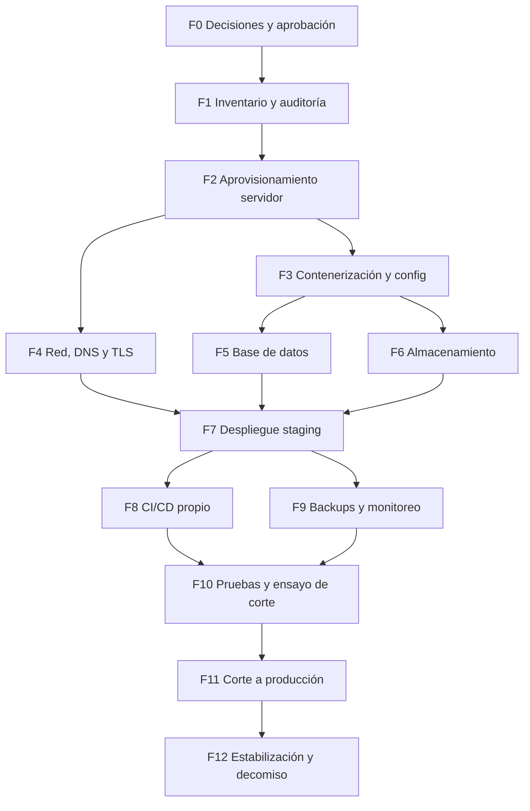

# 🗺️ ROADMAP — Migración de LuXius a Servidor Propio

> **Creado:** 12/11/2026 · **Estado:** PLANIFICADO (no iniciado)
> **Destinatario:** un modelo orquestador (IA) que coordine la migración, con o sin sub-agentes.
> **Dueño humano:** el usuario (único que puede aprobar gates marcados 🔒).

---

## 0. Instrucciones para el Orquestador (LEER PRIMERO)

### 0.1 Tu rol
Sos el orquestador de la migración del ecosistema LuXius desde servicios cloud gratuitos/gestionados hacia un **servidor propio** (físico en el taller o VPS). Tu trabajo es **planificar, delegar, verificar y documentar**; no improvisar infraestructura.

### 0.2 Lectura obligatoria antes de actuar
1. `.agents/AGENTS.md` — reglas del repo (deploy, verify, memoria, secretos).
2. `XANA_MEMORIA_SISTEMA.md` — secciones 1, 2, 4, 6, 8, 9 y 10.
3. `INFORME_REMEDIACION_SISTEMA_LUXIUS.md` — controles de seguridad que **no deben perderse** en la migración.
4. Este documento completo.
5. En `f:\luXius-Backend`: `config.py`, `app.py`, `Dockerfile`, `docker-compose.yml`, `.env.example`, `requirements.txt`, `build.sh`.

### 0.3 Reglas inviolables
| # | Regla |
|---|---|
| R1 | **Cero downtime no planificado.** Producción actual (GitHub Pages + Render + Supabase + R2) sigue viva hasta el gate final de corte. |
| R2 | **Nunca** borrar recursos cloud (Supabase, Render, R2, bucket, repos) sin confirmación explícita 🔒 y sin backup verificado restaurable. Aplicar skill `accidental-data-loss-prevention`. |
| R3 | **Cero secretos en git.** Todo por `.env` (gitignored) o gestor de secretos del servidor. Rotar todo secreto que haya transitado por chat/logs. |
| R4 | Cada fase termina con **verificación medible** (comando + resultado esperado). Sin evidencia, la fase no está cerrada. |
| R5 | Cada fase cerrada se asienta en `XANA_MEMORIA_SISTEMA.md` (Sección 6 bitácora + Sección 8 roadmap) **en el mismo commit**. |
| R6 | Mantener todos los controles de seguridad existentes: RLS/rol restringido, HMAC de telemetría, rate limiting, anti-SSRF, anti-Zip-Slip, triggers de `audit_logs`, `MODO_SIMULACION` AFIP, backups cifrados con `age`. |
| R7 | Cada cambio de código: `npm run verify` (frontend) y `pytest` + `python scripts/tests/check_public_routes.py` (backend) en verde antes de commitear. |
| R8 | Ante ambigüedad o decisión con costo/irreversibilidad → **detenerse y preguntar al usuario**. |
| R9 | No exponer puertos de base de datos a internet. Nunca. |

### 0.4 Cómo delegar
- Una fase = un sub-agente (o worker de swarm) con brief que incluya: objetivo, entradas, entregables, criterio de "hecho" y comandos de verificación de esa fase.
- Fases paralelizables están marcadas con ⚡. Las demás son secuenciales.
- Un sub-agente **verificador** independiente revisa cada gate antes de pasar a la siguiente fase.
- Pedir siempre reporte: qué se hizo, qué se verificó (con output), qué NO se verificó, riesgos abiertos.

---

## 1. Inventario del Estado Actual (punto de partida)

| Componente | Hoy | Detalle |
|---|---|---|
| Frontend | GitHub Pages vía `.github/workflows/deploy.yml` | React 18 + Vite + TS, `base: './'`, PWA (`sw.js`, `version.json`, `versionCheck.ts`). Copia local en Nginx `D:\XignuX\luxius-panel\dist`. |
| Backend | Render (`https://luxius-backend.onrender.com`) | Flask + SQLAlchemy 2.0 + Gunicorn (`gunicorn app:app`), Python 3.12. Repo privado `f:\luXius-Backend`. Ya existen `Dockerfile` y `docker-compose.yml` (revisar vigencia). |
| Base de datos | Supabase PostgreSQL (Session pooler `:5432`, us-east-1) | RLS forzado, `anon`/`authenticated` revocados, tablas `materiales`, `servicios`, `audit_logs` (triggers inmutables). SQLite local `luxius.db` como respaldo. |
| Archivos | Cloudflare R2 `luxius-media` | + bóveda Google Drive (`scripts/sync_r2_to_drive.py`, workflow `r2-to-drive.yml`). |
| Backups | `.github/workflows/db_backup.yml` cada 6 h | `pg_dump` → restore de prueba en `postgres:17-alpine` → cifrado `age` → R2 → alerta Telegram. |
| Keep-alive | `.github/workflows/keep_alive.yml` | Existe solo por el sleep de Render free. **Se elimina** tras migrar. |
| SuiteCraft | `suitecraft_autoupdate.yml` | Estáticos pesados en `public/suitecraft/` (WASM ~98 MB). Requieren headers propios (`_headers`, `.htaccess`). |
| Telegram | Bot `@LuXius_Taller_Bot`, webhook en Render | `TELEGRAM_WEBHOOK_SECRET`, `TELEGRAM_AUTO_WEBHOOK=1`. |
| Monitor taller | XignuX Monitor V2.6 (PC impresión) | Envía telemetría HMAC a `/api/printer/telemetry` (URL del backend configurada en `settings.json`). |
| App móvil | Capacitor (`capacitor.config.json`) | Apunta a `https://luxius-backend.onrender.com`. |
| IA | Gemini / DeepSeek | `GEMINI_API_KEY`, `DEEPSEEK_API_KEY`. Escalador IA usa GPU Vulkan local (`/api/upscaler/status`). |

### 1.1 Variables de entorno conocidas (completar en Fase 1)
`DATABASE_URL`, `JWT_SECRET_KEY`/`JWT_SECRET`, `R2_ACCOUNT_ID`, `R2_ACCESS_KEY_ID`, `R2_SECRET_ACCESS_KEY`, `R2_BUCKET_NAME`, `R2_ENDPOINT_URL`, `TELEGRAM_BOT_TOKEN`, `TELEGRAM_ADMIN_CHAT_ID`, `TELEGRAM_WEBHOOK_SECRET`, `TELEGRAM_AUTO_WEBHOOK`, `GEMINI_API_KEY`, `DEEPSEEK_API_KEY`, `DEEPSEEK_MODEL`, `XANA_LLM_PROVIDER`, `XANA_MAX_IMAGE_PIXELS`, `GOOGLE_SERVICE_ACCOUNT_JSON`, `GOOGLE_DRIVE_FOLDER_ID`, `GOOGLE_OAUTH_TOKEN_FILE`, `OPENAI_API_KEY`, `SMTP_*`, `PRINTER_TELEMETRY_SECRET`, `ENABLE_AFIP_EMISSION`, `DIAS_ANTIGUEDAD`, `DRY_RUN`, `MAX_REINTENTOS_DRIVE`, `BACKOFF_BASE_SEGUNDOS`.

---

## 2. Arquitectura Objetivo



### 2.1 Decisiones a tomar con el usuario 🔒 (antes de la Fase 2)
| ID | Decisión | Opciones | Recomendación por defecto |
|---|---|---|---|
| D1 | Tipo de servidor | (a) PC/servidor físico en taller · (b) VPS (Hetzner, Contabo, DigitalOcean) · (c) híbrido | (c) físico en taller para LAN + VPS chico o Cloudflare Tunnel para acceso externo |
| D2 | Exposición a internet | (a) Cloudflare Tunnel (sin abrir puertos) · (b) IP pública + puertos 80/443 · (c) solo LAN + VPN (Tailscale/WireGuard) | (a) Cloudflare Tunnel |
| D3 | Dominio | Subdominios bajo dominio XignuX (`panel.`, `api.`) | `panel.<dominio>` y `api.<dominio>` |
| D4 | Base de datos | (a) PostgreSQL self-hosted · (b) mantener Supabase | (a), con Supabase como réplica fría durante 30 días |
| D5 | Archivos | (a) seguir en R2 · (b) MinIO local + R2 como offsite | (a) en primera etapa (cero egress, ya funciona); (b) opcional luego |
| D6 | Reverse proxy | Caddy (TLS automático) · Nginx (ya conocido en el taller) | Caddy si hay IP pública; Nginx si se usa Tunnel |
| D7 | Orquestación | Docker Compose · systemd nativo | Docker Compose |
| D8 | SO | Ubuntu Server 24.04 LTS · Windows Server | Ubuntu Server 24.04 LTS (Windows solo si es obligatorio por el RIP) |
| D9 | Energía/red | UPS, IP fija o DDNS, 2º enlace | UPS obligatorio; DDNS innecesario con Tunnel |
| D10 | Mantener GitHub Pages como fallback | sí / no | Sí, 30 días, apuntando a la nueva API |

### 2.2 Requisitos mínimos de hardware (orientativo)
- CPU 4 núcleos, **16 GB RAM** (el build de Vite pide ~4 GB libres; Postgres + backend + IA de upscaling), SSD NVMe 500 GB + disco secundario/externo para backups locales.
- GPU con Vulkan solo si se quiere el escalador IA en el mismo servidor.
- UPS con apagado ordenado (NUT).

---

## 3. Fases de la Migración



---

### F0 — Decisiones y aprobación 🔒
- **Objetivo:** cerrar D1–D10 con el usuario.
- **Acciones:** presentar la tabla 2.1 con costos estimados mensuales; registrar respuestas en este documento (sección 7).
- **Hecho cuando:** todas las decisiones tienen valor elegido y fecha.

### F1 — Inventario y auditoría (solo lectura) ⚡
- **Objetivo:** foto exacta de lo que hay que mover.
- **Acciones:**
  1. Listar todas las variables de entorno usadas en código: `rg "os.environ|os.getenv" f:\luXius-Backend` y `rg "import.meta.env" src`. Cruzar con `.env.example` y con el panel de Render (pedir al usuario captura o lista de nombres, **nunca valores en chat**).
  2. Listar todas las URLs hardcodeadas a producción: `rg "onrender.com|github.io|supabase|r2.cloudflarestorage" -g "!node_modules" -g "!dist"` en ambos repos, en `capacitor.config.json`, en el Monitor (`F:\XignuX_Monitor_Instalador_Taller\settings.json`) y en la landing.
  3. Tamaño de la BD (`SELECT pg_size_pretty(pg_database_size(current_database()));`), listado de tablas, extensiones (`\dx`), roles, triggers y políticas RLS.
  4. Tamaño y cantidad de objetos en R2.
  5. Revisar vigencia de `Dockerfile` y `docker-compose.yml` del backend.
  6. Listar cron jobs/workflows y qué depende de Render.
  7. Endpoints públicos: correr `check_public_routes.py` y guardar la lista blanca.
- **Entregable:** `docs/infra/INVENTARIO_MIGRACION.md` (sin valores secretos).
- **Hecho cuando:** cada variable, URL, tabla, bucket y job tiene destino asignado en la nueva arquitectura.

### F2 — Aprovisionamiento y hardening del servidor
- **Acciones:**
  1. Instalar Ubuntu Server 24.04 LTS, hostname `luxius-srv`, zona horaria `America/Argentina/Buenos_Aires`.
  2. Usuario no-root con sudo; SSH solo por clave, `PermitRootLogin no`, `PasswordAuthentication no`.
  3. Firewall `ufw`: deny incoming por defecto; permitir SSH solo desde LAN/VPN; 80/443 solo si D2=(b).
  4. `fail2ban`, `unattended-upgrades` (solo security), NTP (`systemd-timesyncd`).
  5. Docker Engine + Compose plugin oficiales; usuario en grupo `docker`; `log-driver` con rotación (`max-size=10m`, `max-file=5`).
  6. Estructura de directorios:
     ```
     /opt/luxius/
       compose.yml
       .env                (chmod 600, owner luxius)
       frontend/dist/
       backend/            (git clone de luXius-Backend)
       data/postgres/
       data/uploads/
       backups/
       proxy/              (Caddyfile o nginx.conf)
     ```
  7. UPS + NUT configurado para apagado ordenado. Tailscale/WireGuard para acceso administrativo remoto.
- **Verificación:** `ssh` con contraseña falla; `sudo ufw status` muestra solo reglas esperadas; `docker run hello-world` OK; `timedatectl` sincronizado.

### F3 — Contenerización y configuración ⚡ (paralela a F4)
- **Acciones:**
  1. **Backend:** Dockerfile multi-stage `python:3.12-slim`, usuario no-root, `gunicorn app:app --workers <2*CPU+1> --timeout 120 --bind 0.0.0.0:8000`, healthcheck a `/health`.
  2. **Frontend:** build con `npm run verify` (CI o máquina con RAM suficiente) → `dist/` servido como estático por el proxy. Variable de API apuntando a `https://api.<dominio>` (localizar dónde se define la base URL del backend en `src/` durante F1 y parametrizarla vía `import.meta.env.VITE_API_URL` si está hardcodeada).
  3. **compose.yml** con servicios: `proxy`, `backend`, `postgres` (si D4=a), `backup`, `uptime-kuma`, opcional `cloudflared`, opcional `minio`. Red interna; solo `proxy` publica puertos (o ninguno si Tunnel).
  4. `.env` del servidor generado desde plantilla `deploy/.env.server.example` (versionada sin valores).
  5. CORS del backend: permitir solo `https://panel.<dominio>` (+ origen de GitHub Pages durante la transición + `capacitor://localhost`/`https://localhost` para la app).
  6. Headers de SuiteCraft: replicar `_headers`/`.htaccess` (COOP/COEP, `application/wasm`, cache largo) en el proxy.
  7. Headers de seguridad globales: HSTS, `X-Content-Type-Options`, `Referrer-Policy`, CSP equivalente a la actual; CSP `sandbox` para SVG en `/uploads`.
  8. `client_max_body_size` / límite de request acorde a uploads (≥ 200 MB; el backend ya limita 150 MB de descarga y 250 MB de descompresión).
- **Verificación:** `docker compose up -d` en el servidor levanta todo `healthy`; `curl -k https://localhost/health` → 200.

### F4 — Red, DNS y TLS ⚡
- **Acciones:**
  1. DNS en Cloudflare: `panel.<dominio>`, `api.<dominio>` (y `status.<dominio>` para Uptime Kuma, protegido con Cloudflare Access).
  2. Si D2=Tunnel: `cloudflared` como servicio en compose, rutas hacia `proxy:80`. Si IP pública: Caddy con Let's Encrypt automático.
  3. TTL bajo (300 s) en los registros 48 h antes del corte.
  4. Resolver acceso LAN: el Monitor de la PC de impresión puede usar IP LAN directa (con HTTPS interno o token HMAC sobre LAN) para no depender de internet.
- **Verificación:** `curl -I https://api.<dominio>/health` → 200 con certificado válido; SSL Labs ≥ A.

### F5 — Base de datos
- **Acciones (si D4 = self-hosted):**
  1. PostgreSQL **17** (misma major que el restore de prueba de `db_backup.yml`), volumen en `data/postgres`, sin puerto publicado.
  2. Crear roles: `luxius_owner` (dueño del esquema, solo migraciones) y `luxius_app` (rol restringido de la app, equivalente al de `migrations/001_audit_logs_immutability.sql`).
  3. Migración inicial (ensayo): `pg_dump --format=custom --no-owner --no-acl` desde Supabase (Session pooler) → `pg_restore` en el nuevo Postgres. Omitir esquemas propios de Supabase (`auth`, `storage`, `realtime`, `supabase_*`, `extensions`, `graphql*`, `vault`, `pgsodium`) salvo que F1 detecte uso real.
  4. Reaplicar: triggers de inmutabilidad de `audit_logs`, `GRANT`s mínimos a `luxius_app`, revisar si RLS sigue teniendo sentido (no hay `anon` fuera de Supabase; mantener `FORCE RLS` solo si hay políticas útiles, si no documentar la decisión).
  5. Validación de integridad: conteo de filas por tabla en origen vs destino, `SUM(total)` de `presupuestos`, saldos de `clientes`, último `audit_logs.id`. Script `scripts/infra/compare_db_counts.py` (lee ambos DSN de env).
  6. Tuning básico: `shared_buffers` 25% RAM, `effective_cache_size` 50–75%, `max_connections` acorde a workers de Gunicorn.
- **Verificación:** script de comparación con 0 diferencias; backend apuntando al nuevo `DATABASE_URL` pasa `pytest` y `test_security_suite.py`.

### F6 — Almacenamiento de archivos ⚡
- **D5=a (seguir en R2):** solo verificar credenciales nuevas (rotadas) con permisos mínimos sobre `luxius-media`.
- **D5=b (MinIO local):** `rclone sync r2:luxius-media minio:luxius-media`, verificar con `rclone check`; configurar `R2_ENDPOINT_URL` al MinIO interno; mantener R2 como destino de backup offsite.
- Revisar que el pipeline R2 → Drive (`r2-to-drive.yml`) siga funcionando o moverlo a cron en el servidor.
- **Verificación:** subir, listar, descargar y borrar un archivo de prueba desde la UI en staging.

### F7 — Despliegue en staging (en paralelo a producción)
- **Acciones:**
  1. Levantar todo bajo `staging-panel.<dominio>` / `staging-api.<dominio>` con copia de la BD (F5) — **nunca** apuntar staging a la BD productiva de Supabase con escritura.
  2. Telegram: usar un **bot de prueba** distinto para no robar el webhook del bot real (`TELEGRAM_AUTO_WEBHOOK=0` en staging).
  3. AFIP: `ENABLE_AFIP_EMISSION` ausente/false.
  4. Monitor del taller: configurar una instancia de prueba o enviar telemetría firmada simulada.
- **Verificación (checklist funcional):** login de cada rol; crear/editar/cambiar estado de OT; soft-delete y restore; presupuestador y PDF; stock y alertas; cloud import (Drive/WeTransfer); Xpress Viewer + SuiteCraft (carga WASM); Print Den con telemetría; Xana chat (function calling); escalador IA; PWA instalable y `versionCheck` detecta nueva versión.

### F8 — CI/CD propio ⚡
- **Opción recomendada:** GitHub Actions sigue compilando y testeando; el deploy al servidor se hace con un **self-hosted runner** dentro del servidor (sin abrir SSH a internet) o con `rsync` sobre Tailscale.
- **Acciones:**
  1. Nuevo workflow `deploy_selfhosted.yml`: `npm ci` → `npm run verify` → publicar `dist/` en `/opt/luxius/frontend/dist` de forma atómica (directorio versionado + symlink `current`, conservar 5 releases para rollback).
  2. Backend: workflow en `luXius-Backend` → tests → `docker compose build backend && docker compose up -d backend` con healthcheck; rollback automático si `/health` falla.
  3. Mientras dure la transición, `deploy.yml` (GitHub Pages) **se mantiene**. Al decomisar Pages, actualizar `.agents/AGENTS.md`, `scripts/deploy_gh_pages.ps1` y la Sección 2 de la memoria con el nuevo flujo.
  4. Script de verificación equivalente a `deploy_gh_pages.ps1`: comparar `version.json` servido vs commit de `master`.
- **Verificación:** un commit trivial llega solo al servidor en < 5 min y el script de verificación dice `[OK]`.

### F9 — Backups, monitoreo y alertas ⚡
- **Backups (regla 3-2-1):**
  1. Contenedor/cron cada 6 h: `pg_dump -Fc` → restore de prueba en contenedor efímero `postgres:17-alpine` con conteo de filas → cifrado `age` (clave pública en el servidor, **privada fuera del servidor**) → copia local en disco secundario + copia offsite en R2.
  2. Retención: 7 diarios, 4 semanales, 12 mensuales.
  3. Backup de `/opt/luxius/.env`, configs del proxy y `data/uploads` (si MinIO) cifrado.
  4. Alerta Telegram ante fallo; heartbeat diario de éxito.
  5. **Simulacro de restauración documentado** (servidor limpio → servicio operativo) con tiempo medido (RTO objetivo ≤ 2 h, RPO ≤ 6 h).
- **Monitoreo:** Uptime Kuma (`/health` frontend+backend, certificado, disco), alertas a Telegram; `node_exporter`/Netdata opcional; alertas de disco > 80%, RAM, temperatura, estado UPS.
- **Logs:** rotación Docker + logs de acceso del proxy 30 días; nunca loguear tokens ni DSN.
- **Verificación:** forzar fallo de backup → llega alerta; apagar backend → Uptime Kuma alerta en < 2 min.

### F10 — Pruebas integrales y ensayo de corte
- **Acciones:**
  1. Repetir el checklist de F7 completo en staging con datos frescos.
  2. Pruebas de seguridad: `test_security_suite.py`, `check_public_routes.py`, escaneo externo de puertos (`nmap` desde fuera: solo 443 o nada si Tunnel), cabeceras, intento de path traversal y SSRF.
  3. Prueba de carga liviana (k6/locust, 20 usuarios concurrentes) sobre endpoints de órdenes.
  4. **Ensayo general de corte** cronometrado (F11 completa sobre staging), incluido el rollback.
- **Hecho cuando:** checklist 100%, ensayo de corte < ventana planificada, rollback probado.

### F11 — Corte a producción 🔒
**Ventana sugerida:** domingo por la noche (taller cerrado). Avisar a usuarios 48 h antes.

| Paso | Acción | Verificación |
|---|---|---|
| 1 | Congelar escrituras: modo mantenimiento en Render (o escalar a 0) y banner en frontend | Ninguna escritura nueva en Supabase |
| 2 | Backup final de Supabase + backup final de R2 (si D5=b) | Archivo cifrado verificado |
| 3 | `pg_dump` final → `pg_restore` en servidor propio | Script de comparación 0 diferencias |
| 4 | Sincronización final de archivos (`rclone sync` si aplica) | `rclone check` OK |
| 5 | Levantar backend propio con `DATABASE_URL` nuevo | `/health` 200 |
| 6 | Re-registrar webhook de Telegram al nuevo `api.<dominio>` | `getWebhookInfo` muestra la nueva URL, sin errores |
| 7 | Actualizar URL del backend en: Monitor del taller (`settings.json`), `capacitor.config.json` (nuevo APK), landing, frontend build | Telemetría llega; app móvil hace login |
| 8 | Publicar frontend en `panel.<dominio>`; frontend de GitHub Pages apuntando a la nueva API (fallback) | Ambos frontends funcionan contra la nueva API |
| 9 | Smoke test con el usuario (login, OT nueva, PDF, telemetría) | Confirmación del usuario |
| 10 | Quitar modo mantenimiento | Operación normal |

**Criterios de rollback (cualquiera dispara volver a Render+Supabase):** `/health` inestable > 15 min, pérdida/inconsistencia de datos, login roto, telemetría o Telegram caídos sin fix en 30 min.
**Rollback:** reactivar Render con el `DATABASE_URL` de Supabase, re-registrar webhook, revertir URLs. Las escrituras hechas en el servidor nuevo durante la ventana se exportan y re-aplican manualmente (por eso la ventana debe ser corta y con taller cerrado).

### F12 — Estabilización y decomiso (30 días) 🔒
- Días 1–7: revisión diaria de logs, backups y alertas.
- Día 7: simulacro de restauración real desde backup del servidor nuevo.
- Día 30, previa confirmación del usuario y backup final verificado:
  - Pausar (no borrar todavía) Render; eliminar `keep_alive.yml`.
  - Supabase: dejar en pausa/solo lectura 30 días más, luego exportar dump final y decidir eliminación 🔒.
  - GitHub Pages: deshabilitar o dejar como página de redirección.
  - Rotar **todos** los secretos (JWT con incremento de `token_version` según `docs/security/JWT_SECRET_ROTATION.md`, R2, Telegram secret, `PRINTER_TELEMETRY_SECRET`, API keys).
  - Actualizar `.agents/AGENTS.md`, `XANA_MEMORIA_SISTEMA.md` (secciones 1, 2, 4, 7), `README.md`, `SECURITY.md`, `ESPECIFICACION_TECNICA_ECOSISTEMA_LUXIUS.md`.

---

## 4. Matriz de Riesgos

| Riesgo | Impacto | Mitigación |
|---|---|---|
| Corte de luz / internet en el taller | Sistema inaccesible | UPS + NUT; Tunnel reconecta solo; evaluar VPS como frontal o failover a Render pausado |
| Falla de disco | Pérdida de datos | Backups 3-2-1 cada 6 h, restore probado, SMART monitoreado |
| Exposición de Postgres | Robo de datos | Sin puertos publicados, red interna Docker, firewall |
| Webhook de Telegram duplicado | Bot muerto o comandos dobles | Bot de prueba en staging, re-registro solo en F11 |
| URLs viejas en Monitor/APK | Telemetría y app rotas | Inventario F1 + paso 7 de F11 + nuevo APK firmado |
| Build sin RAM | Deploy fallido engañoso | Build en GitHub Actions o servidor con ≥ 16 GB |
| Cache del Service Worker | Usuarios con frontend viejo | `versionCheck.ts` + nuevo `version.json`; cambiar de dominio invalida SW (avisar a usuarios que reinstalen la PWA) |
| Extensiones/roles de Supabase en el dump | Restore fallido | `--no-owner --no-acl`, excluir esquemas Supabase, ensayo en F5 |
| Pérdida de controles de seguridad | Regresión | R6 + `test_security_suite.py` en F10 |

---

## 5. Plantilla de brief para sub-agentes

```
FASE: F<n> — <nombre>
CONTEXTO: leer .agents/AGENTS.md, XANA_MEMORIA_SISTEMA.md y docs/infra/ROADMAP_MIGRACION_SERVIDOR_PROPIO.md (fase F<n>).
OBJETIVO: <objetivo de la fase>
ENTRADAS: <decisiones D*, entregables de fases previas>
NO HACER: borrar recursos cloud, exponer secretos, tocar producción salvo F11.
ENTREGABLES: <archivos/configs/documentos>
HECHO CUANDO: <criterios de verificación de la fase, con comandos>
REPORTE: qué se hizo, evidencia (outputs), qué no se verificó, riesgos abiertos.
```

---

## 6. Checklist maestro (marcar en el mismo commit que se completa)

- [ ] F0 Decisiones D1–D10 aprobadas
- [ ] F1 `INVENTARIO_MIGRACION.md` completo
- [ ] F2 Servidor aprovisionado y endurecido
- [ ] F3 Contenedores y compose funcionando
- [ ] F4 DNS + TLS operativos
- [ ] F5 BD migrada en ensayo con 0 diferencias
- [ ] F6 Almacenamiento verificado
- [ ] F7 Staging con checklist funcional 100%
- [ ] F8 CI/CD propio con rollback
- [ ] F9 Backups + restore probado + monitoreo con alertas
- [ ] F10 Pruebas de seguridad, carga y ensayo de corte
- [ ] F11 Corte a producción realizado
- [ ] F12 Estabilización 30 días + decomiso + rotación de secretos + docs actualizadas

---

## 7. Registro de decisiones (completar en F0)

| ID | Decisión elegida | Fecha | Notas |
|---|---|---|---|
| D1 | | | |
| D2 | | | |
| D3 | | | |
| D4 | | | |
| D5 | | | |
| D6 | | | |
| D7 | | | |
| D8 | | | |
| D9 | | | |
| D10 | | | |
