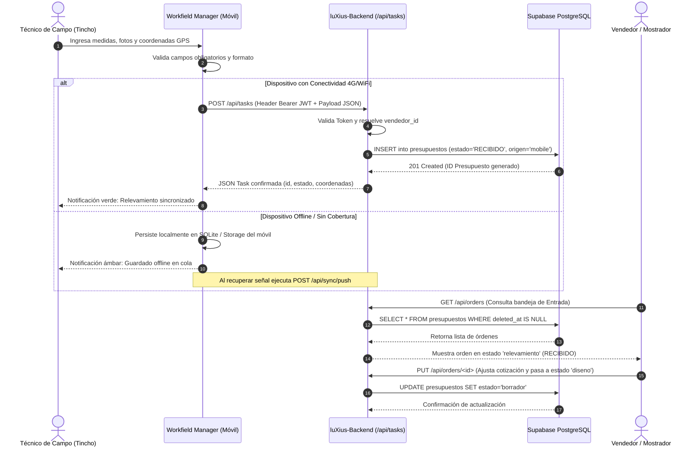
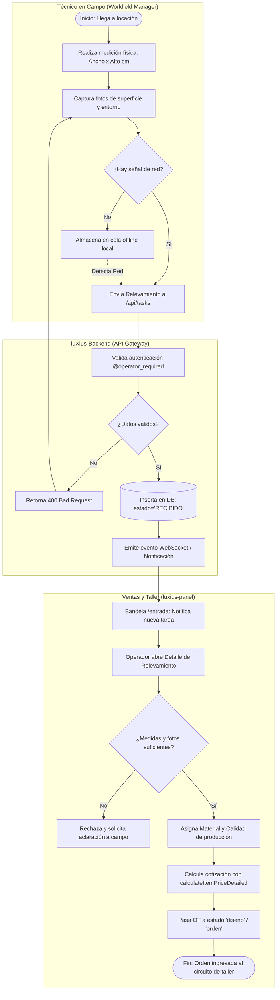
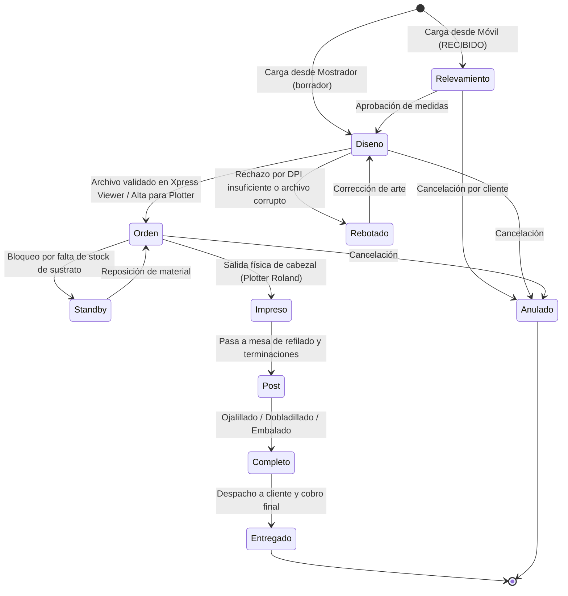
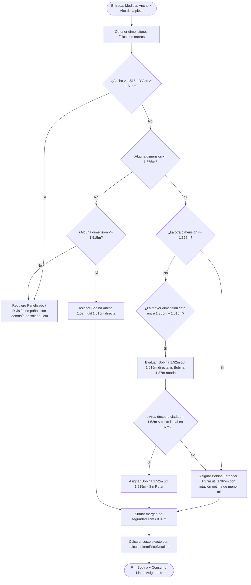
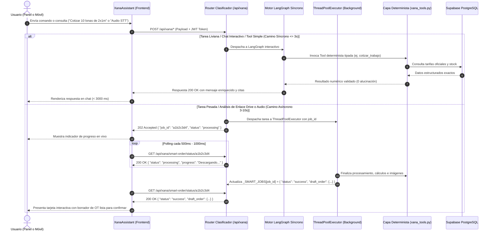
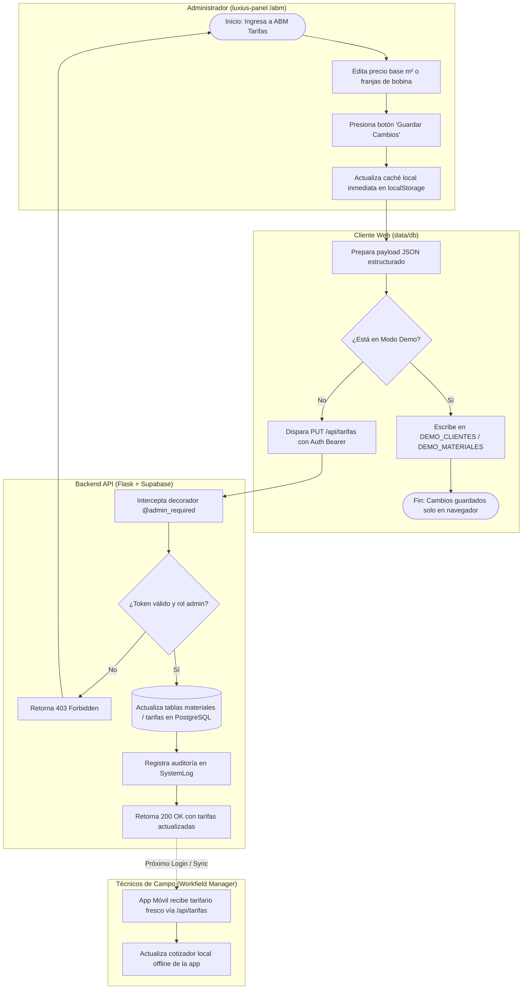

# 📖 Manual de Operaciones Integral del Ecosistema Industrial XignuX / LuXius
**Documentación Técnica Unificada de Arquitectura, Procesos y Procedimientos Operativos Estándar (SOP)**

---

## 1. Control de Versiones y Metadatos

| Atributo | Detalle de Configuración | Fuente / Respaldo Técnico |
| :--- | :--- | :--- |
| **Documento** | Manual de Operaciones ERP & Ecosistema Gráfico Industrial | `docs/Manual/manual.md` |
| **Versión del Manual** | `1.0.0-PROD` (Consolidación Oficial) | Consenso Arquitectónico XignuX |
| **Fecha de Emisión** | 22 de Octubre, 2026 | Timestamps de Auditoría y Git |
| **Frontend Panel** | `luxius-panel` v1.0.0 (React 18.2.0, Vite 5.0.8, TypeScript 5.3.3) | `package.json` / `XANA_MEMORIA_SISTEMA.md` |
| **Backend API** | `luXius-Backend` (Python 3.12, Flask, SQLAlchemy 2.0, Gunicorn) | `render.yaml` / `models.py` |
| **Base de Datos Principal** | PostgreSQL en Supabase (AWS us-east-1, Session Pooler puerto 5432) | Migración 11/10/2026 y 18/10/2026 |
| **Base de Datos Respaldo** | SQLite local (`luxius.db`) | Modo Offline / Contingencia |
| **Almacenamiento Objeto** | Cloudflare R2 (`luxius-media`) + Bóveda Google Drive API v3 | `sync_r2_to_drive.py` |
| **App Móvil de Campo** | `XignuX Workfield Manager` v2.5.1 (Android / Capacitor 8 / JS) | `XANA_MEMORIA_APP_MOVIL.md` |
| **Subsistema IA** | Xana LangGraph Engine (Gemini Flash / DeepSeek-V3 configurable) | `services/xana_graph.py` / Gates A1-A6 |
| **Pipeline CI/CD** | GitHub Actions (`.github/workflows/deploy.yml` → GitHub Pages) | Regla de Oro de Despliegue (19/10/2026) |

---

## 2. Propósito y Alcance del Ecosistema

El ecosistema XignuX / LuXius es una plataforma industrial integrada para la gestión integral de talleres de comunicación visual, gigantografía, cartelería e impresión digital de gran formato. Su arquitectura sincroniza el relevamiento en vía pública, la cotización matemática precisa, la preparación de artes de alta resolución, la imposición de piezas en bobina y el control físico de despacho.

```
┌──────────────────────────────────────────────────────────────────────────────────┐
│                             ECOSISTEMA XIGNUX / LUXIUS                           │
└──────────────────────────────────────────────────────────────────────────────────┘
            │                                                 ▲
            ▼                                                 │
┌─────────────────────────┐                         ┌───────────────────┐
│ Workfield Manager (App) │                         │ Asistente Xana IA │
│ • Relevamiento en sitio │                         │ • LangGraph Core  │
│ • Fotos y coordenadas   │                         │ • Function Tools  │
│ • Firma digital remota  │                         │ • RAG y Memoria   │
└─────────────────────────┘                         └───────────────────┘
            │                                                 ▲
            │ HTTP/JSON Bearer                                │
            ▼                                                 ▼
┌──────────────────────────────────────────────────────────────────────────────────┐
│                       luXius-Backend (Flask / Python 3.12)                       │
│ • Endpoints REST (/api/orders, /api/tasks, /api/xana/*, /api/sync/*)             │
│ • Supabase PostgreSQL (Session Pooler 5432) + Respaldo Local SQLite (luxius.db)  │
│ • Bóveda Multimedia: Cloudflare R2 (Hot) + Google Drive Backup (Cold)            │
└──────────────────────────────────────────────────────────────────────────────────┘
                                    ▲
                                    │ Sincronización REST / JWT
                                    ▼
┌──────────────────────────────────────────────────────────────────────────────────┐
│                        luxius-panel (React 18 + Vite PWA)                        │
│ • Mostrador y Órdenes (/entrada)       • Taller Digital y Bobinas (/taller)      │
│ • Xpress Studio & Redrawer (/diseno)   • Cotizador Paramétrico (/presupuestador) │
│ • Cola de Plotters (/impresion)        • Catálogos ABM y Tarifas (/abm/*)        │
└──────────────────────────────────────────────────────────────────────────────────┘
```

### 2.1 Delimitación de Componentes
1. **`luxius-panel`**: Interfaz web SPA/PWA para administración, ventas, diseño gráfico y control de planta. Compilado con Vite en modo estricto, con 14 módulos diferidos (`React.lazy`) y renderizado acelerado por Canvas para visualización de documentos técnicos y diagramación de corte.
2. **`luXius-Backend`**: Núcleo monolítico transaccional en Flask alojado en Render. Gestiona la lógica de estados de órdenes de trabajo, cálculo de precios por metro lineal/cuadrado, cola asíncrona de procesamiento de archivos pesados y control de seguridad RBAC.
3. **`XignuX Workfield Manager`**: Aplicación móvil para personal técnico y cuadrillas de instalación en campo. Permite capturar medidas, fotografías georreferenciadas, registrar firmas de conformidad de clientes y sincronizar relevamientos hacia el backend central.
4. **`Subsistema Xana`**: Agente cognitivo con arquitectura de grafos de estados (LangGraph) que asiste en diagnósticos de salud del taller, búsqueda de órdenes, cotización algorítmica sin alucinación y transcripción asíncrona de notas de voz hacia borradores de órdenes.

### 2.2 Entorno de Prácticas y Modo Demo (Sandbox en Memoria)
Para capacitación de nuevos operadores y generación de capturas de pantalla sin riesgo de exponer datos comerciales sensibles ni corromper secuencias de base de datos, el panel incorpora un **Modo Sandbox / Demo**:
- **Activación**: Ejecutar en la consola del navegador `localStorage.setItem('luxius_demo_mode', 'true')` o alternar el switch de Modo Demo en la configuración del sistema.
- **Mecanismo de Persistencia**: Las mutaciones se aíslan exclusivamente en memoria volátil y claves locales (`DEMO_CLIENTES_KEY`, `DEMO_ORDENES_KEY`).
- **Dataset Predefinido**: Carga automáticamente el conjunto de datos de prueba (`DEMO_CLIENTES` con identidades ficticias: *Agencia Creativa Aurora*, *Burger Nation*, etc., definidos en `src/data/demoSandboxData.ts`).
- **Aislamiento de Producción**: Las peticiones de sincronización externa quedan silenciadas; ningún comando de alta o baja en modo demo interactúa con la base de datos de Supabase.

---

## 3. Roles, Responsabilidades y Matriz RBAC

El sistema opera bajo el modelo de seguridad `luxius-auth-v6` y control de acceso basado en roles (RBAC).

```
   ┌────────────────────────────────────────────────────────┐
   │             NIVEL 1: ADMINISTRACIÓN CENTRAL            │
   │       (Roles: principal, administrador, admin)         │
   │        Acceso total (*), ABMs, Finanzas, Config        │
   └────────────────────────────────────────────────────────┘
                               │
                               ▼
   ┌────────────────────────────────────────────────────────┐
   │             NIVEL 2: OPERADORES DE TALLER              │
   │   (Roles: vendedor, artista/disenador, impresor/      │
   │           impresion, cortador/refilador)               │
   │    Gestión de OTs, Xpress Viewer, Nesting, Stock       │
   └────────────────────────────────────────────────────────┘
                               │
                               ▼
   ┌────────────────────────────────────────────────────────┐
   │             NIVEL 3: ACCESO EXTERNO / CLIENTE          │
   │                    (Rol: cliente)                      │
   │        Solo lectura/creación de órdenes propias        │
   └────────────────────────────────────────────────────────┘
```

### 3.1 Perfiles del Sistema y Asignación de Funciones
- **Administrador / Principal (`ADMIN_ROLES`)**:
  - *Usuarios Clave*: Adrian (Administración / Sistema), Mirta (Administración / Finanzas).
  - *Alcance*: Control irrestricto del sistema (`*`), altas de usuarios, configuración de tarifarios, conciliación de cuentas bancarias y parámetros del modelo Xana.
- **Vendedor (`vendedor`)**:
  - *Alcance*: Carga de pedidos en `/entrada`, cotización en `/presupuestador`, visualización de cartera en `/abm/clientes` y seguimiento de órdenes propias.
- **Diseñador / Artista (`artista`, `disenador`)**:
  - *Alcance*: Acceso a `/diseno`, `/xpress-viewer` (SuiteCraft: inspección de DPI, sangrado perimetral y vectorizado automático en Redrawer Studio), aprobación técnica y pasaje a cola de impresión.
- **Operario de Taller / Impresor (`impresion`, `impresor`)**:
  - *Personal Asociado*: Carlos (Plotters de Impresión). [SUPUESTO LIMITADO: Quique cumple funciones en planta de impresión/maquinista].
  - *Alcance*: Gestión de `/impresion`, visualización de bobinas en `/taller`, descarga de archivos listos para RIP y cambio de estado a `impreso`.
- **Operario de Terminaciones / Refilador (`cortador`, `refilado`)**:
  - *Personal Asociado*: Agustín (Mesa de Corte y Terminaciones).
  - *Alcance*: Refilado a medida, colocación de ojalillos, costura de dobladillos, laminado y cambio de estado a `post`.
- **Técnico / Colocador de Campo (`tecnico`, `operario`)**:
  - *Personal Asociado*: [SUPUESTO LIMITADO: Tincho cumple funciones de relevamiento en vía pública y montaje final en cliente].
  - *Alcance*: Operación en `Workfield Manager`, consulta de tareas `/api/tasks`, registro de medidas y fotos.
- **Cliente (`cliente`)**:
  - *Alcance*: Acceso de mínimo privilegio estricto; solo puede visualizar y consultar el estado de presupuestos vinculados a su identificador único (`Usuario.client_id == Presupuesto.cliente_id`).

### 3.2 Matriz de Autorización de Rutas y Endpoints

| Módulo / Recurso | Ruta Frontend | Endpoint Backend | Admin | Vendedor | Artista | Impresor | Técnico Campo | Cliente |
| :--- | :--- | :--- | :---: | :---: | :---: | :---: | :---: | :---: |
| **Bandeja de Entrada** | `/entrada` | `GET /api/orders` | ✅ | ✅ | ✅ | ❌ | ❌ | Solo Propias |
| **Nuevo Pedido** | Modal Entrada | `POST /api/orders` | ✅ | ✅ | ❌ | ❌ | ❌ | ✅ (Restringido) |
| **Xpress Viewer** | `/xpress-viewer` | `/api/cloud-import` | ✅ | ❌ | ✅ | ❌ | ❌ | ❌ |
| **Cola de Impresión** | `/impresion` | `GET /api/orders?status=orden`| ✅ | ❌ | ✅ | ✅ | ❌ | ❌ |
| **Nesting Studio 2D**| Modal Taller | `/api/orders/batch` | ✅ | ❌ | ✅ | ✅ | ❌ | ❌ |
| **Control de Stock** | `/stock` | `GET/POST /api/materiales` | ✅ | ❌ | ❌ | ✅ | ❌ | ❌ |
| **Tareas de Campo** | App Móvil | `GET/POST /api/tasks` | ✅ | ✅ | ❌ | ❌ | ✅ | ❌ |
| **Chat Asistente Xana**| Drawer Flotante| `POST /api/xana/chat` | ✅ | ✅ | ✅ | ✅ | ✅ | Rol Cliente |
| **ABM Tarifarios** | `/abm/*` | `POST /api/tarifas` | ✅ | ❌ | ❌ | ❌ | ❌ | ❌ |
| **Conciliación Caja** | `/analiticas`| `/api/finanzas/*` | ✅ | ❌ | ❌ | ❌ | ❌ | ❌ |

---

## 4. Protocolo de Traspaso (Modelo Diagramador ↔ Modelo Ejecutor)

Para garantizar cero discrepancias entre la arquitectura de software y la práctica operativa en planta, se establece el siguiente marco de gobernanza obligatoria:

```
┌─────────────────────────┐                        ┌─────────────────────────┐
│   MODELO DIAGRAMADOR    │                        │     MODELO EJECUTOR     │
│                         │                        │                         │
│ • Delimita alcance      │  Checklist Traspaso    │ • Ficha de SOP          │
│ • Mapea actores y flujos│ ─────────────────────► │ • Pasos reproducibles   │
│ • Diagrama Mermaid      │                        │ • Entradas y Salidas    │
│ • Identifica ramas/error│ ◄───────────────────── │ • Validaciones y Errores│
└─────────────────────────┘   Auditoría de Nodos   └─────────────────────────┘
```

### 4.1 Entregables de Traspaso
El Modelo Diagramador no podrá dar por cerrado un proceso sin suministrar al Modelo Ejecutor:
1. **Identificación de Actores**: Nombre formal del componente (`Workfield Manager`, `luXius-Backend`, `luxius-panel`) y del rol humano responsable.
2. **Matriz de Entradas / Salidas**: Diccionario de datos requerido (payload JSON, parámetros query, headers JWT) y respuesta esperada (código HTTP, campos modificados en BD).
3. **Condiciones de Bifurcación**: Expresión booleana exacta que dispara cada ruta alternativa (ej. `w <= anchoUtil`, `ancho > 1.365m`, `DPI >= 150`).
4. **Catálogo de Errores Esperados**: Respuestas de error tipadas (ej. `401 Unauthorized`, `404 Not Found`, `422 Unprocessable Entity`, `OOM Guard`).

### 4.2 Matriz de Coincidencia (Diagrama vs. Procedimiento)
- **Regla de Cobertura 1:1**: Cada nodo de acción en un diagrama de flujo o de carriles debe corresponder con un paso numerado en el procedimiento operativo estándar (SOP).
- **Consistencia en Puntos de Decisión**: Todo rombo de decisión del diagrama debe tener una sección correlativa de *"Controles y Validaciones"* en la ficha del Ejecutor.
- **Rutas de Escape**: Ningún diagrama puede finalizar en un nodo ciego o sin retorno ante una excepción operativa.

### 4.3 Mecanismo de Arbitraje y Despeje de Ambigüedades
- Si durante la redacción se identifica un parámetro de timeout no documentado, un responsable nominal no definido en código o una regla de negocio divergente:
  1. Se suspende la emisión definitiva del nodo.
  2. Se asienta la anotación formal `[VACÍO TÉCNICO / PENDIENTE DE VALIDACIÓN]`.
  3. Si es indispensable para mantener el flujo operativo, se define un `[SUPUESTO LIMITADO]` basado en las mejores prácticas de la industria gráfica, requiriendo validación por el Jefe de Producción.

---

## 5. Procesos Documentados y Diagramas de Flujo (Modelo Diagramador)

### 📌 Leyenda Formal de Símbolos y Convenciones en Diagramas
- `([Inicio / Fin])`: Terminal de proceso.
- `[Proceso / Acción]`: Operación técnica o cambio de estado.
- `[/Entrada / Salida/]`: Recepción o emisión de datos (JSON, comprobante, archivo).
- `<¿Decisión / Condición?>`: Bifurcación lógica condicional.
- `[(Base de Datos / Persistencia)]`: Escritura o lectura en Supabase / SQLite / R2.
- `==>`: Flujo principal exitoso (*Happy Path*).
- `-.->`: Flujo condicional de excepción o contingencia.

---

### 5.1 Flujo 1: Relevamiento Técnico en Campo y Conversión a Presupuesto / OT

#### Alcance y Descripción
Cubre desde la inspección física en el domicilio del cliente por parte del técnico de campo mediante `Workfield Manager`, la transmisión de medidas, notas y fotografías hacia `luXius-Backend`, hasta la transformación del relevamiento en una Orden de Trabajo oficial en `luxius-panel`.

#### Diagrama de Secuencia de Relevamiento (Capacitor ↔ Flask ↔ Supabase)


#### Diagrama de Carriles (Swimlane): Relevamiento en Campo vs. Aprobación en Taller


---

### 5.2 Flujo 2: Gestión de Cola de Trabajo, Imposición y Despacho en Taller

#### Alcance y Descripción
Abarca el ciclo de vida de la orden en planta gráfica desde su aprobación técnica (`diseno`), optimización de bobina en `Nesting Studio 2D`, envío a producción (`orden`), impresión física en plotter Roland (`impreso`), terminaciones de taller (`post`), empaque final (`completo`) y despacho al cliente (`entregado`).

#### Máquina de Estados de la Orden de Trabajo (Workflow Engine)


#### Diagrama de Decisión: Asignación Heurística de Bobina de Impresión


---

### 5.3 Flujo 3: Ejecución Asíncrona de Consultas y Acciones con Asistente Xana

#### Alcance y Descripción
Detalla la arquitectura de procesamiento cognitivo de Xana mediante LangGraph. Diferencia estrictamente el camino síncrono interactivo (sujeto al budget de latencia Gate A6 $\le 3000\text{ ms}$) del camino asíncrono para tareas pesadas (análisis de archivos, transcodificación de voz a OT y reportes multi-documento vía `job_id` y polling `202 Accepted`).

#### Diagrama de Secuencia: Clasificación de Ruta y Ejecución Asíncrona


---

### 5.4 Flujo 4: Operación de Catálogos ABM y Gestión de Tarifarios

#### Alcance y Descripción
Describe el mantenimiento administrativo de Clientes, Materiales, Máquinas y Vendedores. Incorpora la arquitectura de doble nivel de persistencia (Caché local en navegador / Memoria de sesión + Sincronización REST con backend y PostgreSQL en Supabase).

#### Diagrama de Carriles (Swimlane): Mantenimiento de Tarifas y Propagación


---

## 6. Instrucciones Operativas Paso a Paso (Modelo Ejecutor - SOP)

---

### 📋 SOP-01: Relevamiento en Campo y Carga de Medidas (`Workfield Manager`)
- **Propósito**: Estandarizar la captura física de especificaciones gráficas en vía pública o local comercial para evitar discrepancias milimétricas en taller.
- **Responsable Operativo**: Técnico Instalador / Cuadrilla de Campo (Personal asociado: Tincho).
- **Precondiciones**:
  - Dispositivo móvil Android con `XignuX Workfield Manager` v2.5.1 instalado.
  - Sesión activa con credenciales de operario/técnico (`token JWT` válido).
  - Permisos de Cámara y Ubicación concedidos en el sistema operativo.

#### Procedimiento de Ejecución
1. Abra la aplicación y acceda a la pestaña **Relevamientos / Nueva Tarea** (`+`).
2. Seleccione el **Cliente** del listado desplegable. Si es un cliente nuevo no registrado, pulse *"Nuevo Contacto"* e ingrese Razón Social y Teléfono.
3. En la sección **Medidas Técnicas**:
   - Ingrese el **Ancho** en metros con hasta dos decimales (ej. `2.40`).
   - Ingrese el **Alto** en metros con hasta dos decimales (ej. `1.20`).
4. En la sección **Condición de Montaje y Sustrato**:
   - Seleccione el material sugerido (ej. *Lona Frontlight 13 Oz*, *Vinilo Vehicular*, *Microperforado*).
   - Indique si requiere estructura nueva, refilado a ras o bolsillos para caño.
5. Pulse sobre el botón de **Cámara** y capture al menos 2 fotografías:
   - *Foto 1 (Plano General)*: Fachada completa con referencias métricas.
   - *Foto 2 (Detalle de Fijación)*: Punto de anclaje, tornillería o irregularidades en la pared.
6. Verifique que las **Coordenadas GPS** se encuentren fijadas por el sensor del dispositivo.
7. Pulse el botón **Guardar y Sincronizar**:
   - Si cuenta con señal, el registro emitirá un aviso verde: *"Tarea #XXXX Enviada con Éxito"*.
   - Si no cuenta con señal, el registro permanecerá en la bandeja *"Pendientes de Envío"* hasta restablecer la conexión.

- **Resultado Producido (Salida)**:
  - Registro creado en la tabla `presupuestos` con `estado = 'RECIBIDO'`, `origen = 'mobile'`, coordenadas geográficas y enlaces a imágenes.
- **Controles y Validaciones**:
  - El sistema bloquea el envío si el ancho o alto son $\le 0$.
  - Requiere obligatoriamente al menos una fotografía adjunta.
- **Resolución de Anomalías Frecuentes**:
  - *Error 401 en pantalla*: El token de sesión caducó. Cierre sesión e inicie nuevamente con usuario y contraseña para renovar credenciales en el Keystore seguro.
  - *La app no toma coordenadas*: Active la ubicación de alta precisión en los ajustes de Android y aguarde 5 segundos a cielo abierto.

---

### 📋 SOP-02: Inspección Previa y Aprobación Técnica (`Xpress Viewer / Diseno`)
- **Propósito**: Validar la fidelidad gráfica, resolución real (DPI 1:1), demasías de corte y ausencia de fallas de color antes del envío a los cabezales del plotter.
- **Responsable Operativo**: Diseñador Gráfico / Operador de Preimpresión (Personal asociado: Adrian / Rol Artista).
- **Precondiciones**:
  - Orden en estado `diseno` en el panel web.
  - Archivo de producción adjunto (PDF vectorial, TIFF, JPG alta calidad).

#### Procedimiento de Ejecución
1. Ingrese a la vista de **Diseño** (`/diseno`) o pulse el botón **👁️ Xpress** en la fila de la orden en la tabla de Entrada.
2. El sistema abrirá el visor técnico de alta resolución `XpressViewer.tsx`.
3. Verifique el **Semáforo de Resolución DPI**:
   - 🟢 **Verde (> 150 DPI)**: Óptimo para cartelería cercana y vinilos.
   - 🟡 **Ámbar (72 a 150 DPI)**: Apto para gigantografía y visualización lejana (> 3 metros).
   - 🔴 **Rojo (< 72 DPI)**: Crítico. Riesgo severo de pixelado.
4. Si la resolución es crítica (< 72 DPI):
   - Pulse sobre la herramienta **Escalador Inteligente IA (Super-Resolution)**.
   - Seleccione el factor de escala (2x o 4x) para ejecutar el modelo de reconstrucción en backend y sustituir el bitmap defectuoso.
5. Si el arte contiene logotipos rasterizados de baja definición:
   - Abra la pestaña **Redrawer Studio** e inicialice el motor vectorial ImageTracer para vectorizar contornos y exportar curvas limpias.
6. Calibre el **Sangrado y Demasías**:
   - Para vinilos con corte a ras: configurar sangría perimetral de **10 mm (1 cm)**.
   - Para lonas con dobladillo y ojalillos: configurar demasía perimetral de **50 mm (5 cm)**.
   - Para lonas con bolsillo para caño: configurar demasía de **100 mm (10 cm)**.
7. Si el archivo cumple todas las especificaciones:
   - Haga clic en **Aprobar para Impresión**.
   - Seleccione el estado destino: **`orden`**.

- **Resultado Producido (Salida)**:
  - Orden actualizada a estado `orden` (visible en `/impresion`).
  - Metadatos de imagen guardados en la orden (`anchoReal`, `altoReal`, `dpi`, `colorMode`).
- **Controles y Validaciones**:
  - Archivos con modo de color RGB generarán una advertencia visual de virado a CMYK.
  - No se permite aprobar archivos con tamaño físico superior a 500 MB (guard anti-OOM).
- **Resolución de Anomalías Frecuentes**:
  - *El visor queda en blanco*: El enlace del archivo puede estar dañado o bloqueado por CORS. Descargue el archivo original de Google Drive/R2 e impórtelo manualmente.

---

### 📋 SOP-03: Imposición en Bobina y Creación de Lote (`Nesting Studio 2D`)
- **Propósito**: Agrupar múltiples trabajos de igual sustrato minimizando el desperdicio de material y automatizando el cálculo de metros lineales gastados.
- **Responsable Operativo**: Operario de Taller / Maquinista (Personal asociado: Carlos / Quique).
- **Precondiciones**:
  - Dos o más órdenes en estado `orden` que compartan el mismo material (ej. *Vinilo Vehicular VV*).

#### Procedimiento de Ejecución
1. Ingrese a la vista de **Taller / Impresión** (`/impresion` o `/taller`).
2. Marque las casillas de verificación de las órdenes compatibles que desea unificar.
3. En la barra de herramientas superior, haga clic en el botón **📐 Nesting Studio**.
4. En el modal interactivo de Nesting:
   - Seleccione el **Ancho de Bobina Física**:
     - `1.37 m` (Ancho útil: `1.365 m`).
     - `1.52 m` (Ancho comercial 1.50m / Ancho útil: `1.515 m`).
   - Configure el **Espaciado de Corte (Gap)**: Valor por defecto de seguridad: `10 mm (0.01 m)`.
   - Active o desactive la opción **Permitir Rotación a 90°** según la orientación de la veta del material.
5. Ajuste las copias por pieza en tiempo real utilizando los controles `[-] [N] [+]` en el panel lateral de piezas.
6. Inspeccione visualmente el plano de imposición renderizado en el Canvas:
   - Verifique que ninguna pieza sobrepase la línea roja discontinua que delimita el ancho útil de la bobina.
   - Compruebe las cotas métricas y las etiquetas con número de OT centradas en cada pieza.
7. Haga clic en **Confirmar Lote y Exportar**:
   - Seleccione **Unificar en Batch** para crear una orden consolidada o **Exportar Plano PNG de Guía** para el operador del plotter.

- **Resultado Producido (Salida)**:
  - Generación de `batchId` único en la base de datos que vincula a las órdenes hijas.
  - Recálculo exacto del consumo de metros lineales (`ml`) y material remanente.
- **Controles y Validaciones**:
  - Si una pieza individual excede el ancho útil seleccionado (ej. pieza de 1.45m en bobina de 1.37m), el sistema la resaltará en color rojo bloqueando la confirmación hasta cambiar la bobina a 1.52m o activar el panelizado.
- **Resolución de Anomalías Frecuentes**:
  - *Discrepancia en metros lineales calculados*: Verifique que el margen de seguridad (`safetyMargin = 0.01`) y la separación entre copias no estén configurados en valores excesivos en la pantalla de ajustes.

---

### 📋 SOP-04: Ejecución de Impresión y Control Físico en Plotter
- **Propósito**: Transferir el archivo validado a la cola del software RIP (Roland VersaWorks) y registrar el inicio y fin del tiraje físico en planta.
- **Responsable Operativo**: Impresor de Planta (Personal asociado: Carlos / Quique).
- **Precondiciones**:
  - Orden en estado `orden`.
  - Plotter calibrado con nivel de tintas suficiente (> 20% en todos los cartuchos).
  - Rollo de sustrato cargado y alineado con guías de presión activas.

#### Procedimiento de Ejecución
1. En la fila correspondiente de la orden en `/impresion`, haga clic en **Descargar Arte 1:1**.
2. Guarde el archivo en el directorio local de entrada de VersaWorks (`C:\VersaWorks\Input\Queue_A`).
3. En el software VersaWorks:
   - Verifique que la orientación coincida con el plano de Nesting de LuXius.
   - Aplique el perfil de color correspondiente al sustrato (ej. *Generic Vinyl 1 - Standard High Quality*).
   - Envíe el trabajo a cola de ripeo e impresión (`Rip & Print`).
4. En `luxius-panel`:
   - Cambie el estado de la orden a **`En Impresión`** [En código mapeado a estado visual activo].
5. Una vez que el plotter expulsó el trabajo por completo y la tinta secó:
   - Realice una inspección ocular descartando bandas blancas (*banding*), gotas o suciedad de cabezal.
   - Cambie el estado de la orden a **`impreso`**.

- **Resultado Producido (Salida)**:
  - La orden sale de la cola de impresión y pasa a la cola de la estación de terminaciones y refilado.
  - En el visualizador WorkshopCanvas, el operario Carlos camina hacia la estación de despacho llevando el rollo impreso.
- **Controles y Validaciones**:
  - Ante rotura de material o falta de tinta durante el tiraje, el operario debe colocar inmediatamente la orden en estado **`standby`** o **`rebotado`** indicando la causa para solicitar reposición urgente de rollo.

---

### 📋 SOP-05: Terminaciones, Refilado y Empaque
- **Propósito**: Realizar cortes perimetrales, refuerzos mecánicos y embalaje protector identificando el bulto con su rótulo industrial oficial.
- **Responsable Operativo**: Operario de Terminaciones / Empaque (Personal asociado: Agustín en refilado / Mirta en empaque).
- **Precondiciones**:
  - Orden en estado `impreso`.
  - Sustrato seco y reposado en mesa de trabajo.

#### Procedimiento de Ejecución
1. El cortador toma el rollo y consulta las instrucciones especiales de la OT:
   - Si requiere **Refilado al Ras**: Cortar con regla metálica y cúter bisturí exactamente sobre la marca perimetral de corte.
   - Si requiere **Dobladillo Térmico / Refuerzo**: Plegar los 5 cm de demasía hacia el dorso y aplicar soldadura por alta frecuencia o cinta bifaz de alto impacto.
   - Si requiere **Ojalillos**: Aplicar ojalillos metálicos reforzados en las cuatro esquinas y distribuidos cada 50 cm o 100 cm en el perímetro según lo especificado en la orden.
   - Si requiere **Laminado**: Pasar la pieza por la calandra laminadora en frío aplicando vinilo cristal UV libre de burbujas.
2. Al finalizar las tareas mecánicas, cambie el estado de la orden a **`post`**.
3. El empaquetador enrolla el trabajo con la cara impresa hacia afuera y envuelve con film stretch protector.
4. En `luxius-panel`, haga clic en el botón **🏷️ Etiqueta de Producción**:
   - El sistema abrirá la utilidad de generación de rótulos térmicos en PDF (`generateLabelPdf.ts`).
   - Imprima la etiqueta adhesiva que contiene: Código de OT (`OT-XXXXXXXX`), Nombre del Cliente, Medidas, Fecha de Entrega y Código QR de auditoría.
5. Pegue la etiqueta visible en el bulto y cambie el estado a **`completo`**.

- **Resultado Producido (Salida)**:
  - Bulto rotulado y depositado en la estantería de despacho.
  - Estado de la orden marcado como `completo` (Listo para entrega / Espera de retiro).

---

### 📋 SOP-06: Entrega, Despacho y Cobro Final
- **Propósito**: Formalizar la entrega material al cliente o comisionista y liquidar los saldos financieros pendientes.
- **Responsable Operativo**: Administrador / Mostrador (Personal asociado: Mirta).
- **Precondiciones**:
  - Orden en estado `completo`.

#### Procedimiento de Ejecución
1. Al presentarse el cliente en mostrador o comisionista de flete:
   - Busque la orden en la barra de búsqueda rápida ingresando el código `OT-XXXXXXXX` o escaneando el código QR de la etiqueta.
2. Compruebe el estado financiero de la orden:
   - Si la orden posee **Saldo Pendiente**:
     - Registre el cobro en efectivo, transferencia o débito en el modal de cobranza.
     - Ingrese el número de comprobante de transferencia bancaria si corresponde.
3. Haga entrega física de los bultos.
4. Cambie el estado de la orden a **`entregado`**.

- **Resultado Producido (Salida)**:
  - Orden archivada con éxito en el historial operativo.
  - Saldo en cuenta corriente liquidado e impactado en las métricas contables de `/analiticas`.

---

## 7. Controles, Gestión de Excepciones y Escalamiento Técnico

```
┌──────────────────────────────────────────────────────────────────────────────────┐
│                         MATRIZ DE CONTINGENCIAS TÉCNICAS                         │
└──────────────────────────────────────────────────────────────────────────────────┘
            │
            ├─► Caída de Internet / Falla en Render Nube
            │   └─► Alternar a Servidor Local Nginx (http://localhost:5000)
            │
            ├─► Archivos Gigantes (> 500 MB o > 500 MP)
            │   └─► Bloqueo preventivo por Guard Anti-OOM en ingesta
            │
            ├─► Quiebre de Stock de Sustrato o Tinta
            │   └─► Pasar OT a estado 'standby' y emitir alerta en Xana
            │
            └─► Bloqueo de Conexiones DB Supabase
                └─► Verificar Session Pooler en puerto 5432 (No Directo)
```

### 7.1 Protocolo de Contingencia por Caída de Conectividad a Internet
Si el taller sufre un corte del servicio de fibra óptica que interrumpe la comunicación con el servidor central en la nube (`luxius-backend.onrender.com`):
1. **Conmutación Inmediata a Red Local**:
   - Abrir en los navegadores de las estaciones de trabajo la dirección IP local del servidor de contingencia: `http://192.168.1.45:5000` o `http://localhost/` (servido por Nginx local).
   - Los datos se leerán y escribirán temporalmente sobre la base local SQLite (`luxius.db`).
2. **Operación en App Móvil (`Workfield Manager`)**:
   - La aplicación detectará la pérdida de conectividad y almacenará todas las mediciones y fotografías en el almacenamiento seguro del dispositivo.
3. **Restablecimiento y Re-sincronización**:
   - Al retornar el enlace a internet, ejecutar el script de sincronización bidireccional `/api/sync/push` para volcar los registros acumulados hacia Supabase PostgreSQL sin duplicar claves primarias (mecanismo idempotente por UUID).

### 7.2 Protección de Memoria y Guards Anti-OOM
Para impedir que la subida o procesamiento de gigantografías desmedidas agote la memoria RAM de los servidores o cuelgue los navegadores de diseño:
1. **Guardia de Ingesta por Peso**: Todo archivo recibido en `/api/cloud-import` o subida directa con peso superior a **500 MB** es rechazado inmediatamente con código `413 Payload Too Large`.
2. **Guardia de Descompresión en Píxeles**: El backend impone el límite estricto `Image.MAX_IMAGE_PIXELS = 500_000_000` (500 Megapíxeles, configurable por `XANA_MAX_IMAGE_PIXELS`).
   - *Tolerancia admitida*: Gigantografía a 150 DPI reales ($\approx 223\text{ MP}$) es aceptada.
   - *Ataques / Bombas de descompresión*: Archivos inflados a 300 DPI ($\approx 893\text{ MP}$) son abortados antes de su carga en RAM.
3. **Optimización de Miniaturas en PDFs**: Los generadores de presupuesto (`generatePdfBudget.ts` y `pdfImageOptimizer.ts`) escalan físicamente las imágenes a un máximo de **360x360 px** en Canvas off-screen con compresión JPEG 0.72 antes de renderizar la impresión, manteniendo el peso del documento por debajo de 2 MB (reducción superior al 95%).

### 7.3 Timeouts y Seguridad en Consultas Analíticas (Gate A4)
Para evitar que consultas estadísticas complejas bloqueen el hilo de Flask en producción:
- Todas las consultas del asistente Xana sobre métricas de facturación y ranking de clientes corren contra **Vistas de Solo Lectura** parametrizadas (`v_ventas_cliente`, `v_consumo_material`).
- **Timeout Rígido**: Límite de ejecución de **3.0 segundos**. Si la base de datos no responde en ese lapso, la petición se cancela.
- **Tope de Registros**: Retorno limitado a un máximo de **100 filas** por consulta analítica.
- **Prohibición de Text-to-SQL Libre**: Queda terminantemente prohibido que un LLM genere sentencias SQL arbitrarias. Toda interacción analítica se canaliza a través de herramientas tipadas deterministas.

---

## 8. Glosario Unificado de Términos

### 8.1 Términos de Negocio Gráfico Industrial
- **Banding**: Defecto de impresión visualizado como líneas o estrías horizontales a lo largo del paso del cabezal, originado por inyectores tapados o desalineación bidireccional.
- **Bobina / Rollo**: Presentación cilíndrica continua del sustrato (vinilo, lona, papel). Las medidas estándar de taller son 1.37 m (útil 1.365 m) y 1.52 m (comercialmente llamada de 1.50 m, con útil de 1.515 m).
- **Demasía / Sangría**: Margen perimetral adicional agregado al arte gráfico original para absorber tolerancias de corte o permitir el doblado y costura sin recortar elementos del diseño.
- **Dobladillo**: Plegado y pegado/soldado térmico del borde de una lona para dotar de resistencia mecánica a la tracción perimetral.
- **Lona Backlight**: Sustrato translúcido diseñado especialmente para ser iluminado desde la parte trasera en cajas de luz y marquesinas luminosas.
- **Lona Frontlight**: Tejido de poliéster recubierto con PVC blanco de 13 Oz, diseñado para ser iluminado frontalmente. Es el sustrato estándar para cartelería exterior.
- **Metro Lineal (ml)**: Medida longitudinal de consumo a lo largo del rollo, independientemente del ancho de la bobina utilizada.
- **Nesting 2D**: Algoritmo de optimización geométrica computacional que acomoda múltiples piezas rectangulares o irregulares en una superficie continua para minimizar el scrap (desperdicio).
- **Ojalillos**: Anillos metálicos remachados a lo largo del perímetro de lonas y pasacalles que permiten pasar cables o precintos de sujeción sin rasgar el tejido.
- **Panelizado**: Técnica de fraccionamiento de una imagen de grandes dimensiones en paños verticales u horizontales paralelos con un solape de 2 a 3 cm cuando las medidas físicas superan el ancho máximo del plotter.
- **Plotter**: Máquina de impresión de gran formato por inyección de tinta ecosolvente o UV de cabezal móvil continuo.
- **Refilado**: Acción de cortar y descartar los márgenes blancos sobrantes del sustrato para dejar la pieza a sus dimensiones netas finales.
- **RIP (Raster Image Processor)**: Software intermediario (ej. Roland VersaWorks) que traduce curvas vectoriales e imágenes bitmap en comandos de micro-gotas y pasadas físicas para el cabezal de impresión.
- **Vinilo Microperforado**: Film de PVC con perforaciones regulares que permite proyectar imágenes hacia el exterior mientras mantiene visibilidad total desde el interior (utilizado en vidrieras y lunetas de vehículos).
- **Vinilo Vehicular (VV)**: Película de vinilo fundido de alta maleabilidad y adhesivo solvente permanente formulada para adaptarse a las curvas complejas de carrocerías automotrices.

### 8.2 Términos Técnicos y de Software
- **Gate A1 a A6**: Puntos de verificación y mitigación de riesgos de la arquitectura Xana (A1: Cross-modelo, A2: Shadow Mode, A3: Límite RAG, A4: Anti-alucinación, A5: Seguridad Auth/OOM, A6: Budget Latencia Chat $\le 3\text{ s}$).
- **Job ID / Polling 202**: Patrón asíncrono en el cual el servidor responde inmediatamente con código `202 Accepted` y un identificador único de tarea, permitiendo al cliente consultar periódicamente el avance sin agotar timeouts HTTP.
- **Modo Sandbox**: Entorno volátil en memoria del navegador que permite simular la operatoria del sistema con clientes y órdenes ficticias sin impactar en la base de datos de producción.
- **OT (Orden de Trabajo)**: Identificador unívoco alfanumérico generado en base al UUID primario de la orden con el formato estandarizado `OT-XXXXXXXX`.
- **RBAC (Role-Based Access Control)**: Modelo de control de acceso que restringe o habilita vistas y endpoints según el rol asignado en la sesión del usuario.
- **Session Pooler**: Mecanismo de gestión de conexiones de Supabase (puerto 5432) que mantiene vivas las sesiones transaccionales sin agotar el límite de conexiones concurrentes de PostgreSQL.

---

## 9. Inventario de Elementos Pendientes de Validar

En cumplimiento estricto con la Regla de Oro Anti-Invención, a continuación se consolida la totalidad de vacíos técnicos, supuestos limitados y parámetros pendientes de confirmación definitiva por el equipo directivo de XignuX:

| ID Referencia | Módulo / Componente | Elemento Registrado | Clasificación | Supuesto Limitado Aplicado en este Manual | Acción Requerida para Homologación |
| :---: | :--- | :--- | :---: | :--- | :--- |
| **VAL-001** | Recursos Humanos / Roles | Responsabilidad nominal de "Tincho" | `[SUPUESTO LIMITADO / PENDIENTE DE VALIDACIÓN]` | Asignado como Técnico / Instalador en campo, responsable principal de la captura en `Workfield Manager`. | Confirmar denominación de puesto y rol exacto en el sistema. |
| **VAL-002** | Recursos Humanos / Roles | Responsabilidad nominal de "Quique" | `[SUPUESTO LIMITADO / PENDIENTE DE VALIDACIÓN]` | Asignado como Maquinista / Operario de impresión física y corte en taller. | Confirmar denominación de puesto y rol exacto en el sistema. |
| **VAL-003** | Auth / Sesiones | Timeout exacto de inactividad JWT en Panel | `[VACÍO TÉCNICO / PENDIENTE DE VALIDACIÓN]` | Supuesto de expiración de token en 8 horas laborales continuas. | Definir parámetro de expiración de JWT en variable de entorno backend (`JWT_EXPIRATION_DELTA`). |
| **VAL-004** | Taller / Imposición | Automatización de Hot Folder Roland VersaWorks | `[ESTADO PAUSADO]` | Declarado en pausa técnica hasta realizar pruebas físicas in situ frente a la máquina en planta. | Desarrollar Daemon local de copia automática tras validación de `docs/roland/VERSAWORKS_4_NOTAS.md`. |
| **VAL-005** | Móvil / Hardware | Modelo exacto de impresora térmica de etiquetas | `[VACÍO TÉCNICO / PENDIENTE DE VALIDACIÓN]` | Generación genérica de PDF térmica estándar en 100x150 mm. | Especificar fabricante y protocolo (Zebra ZPL, ESC/POS o Driver Windows) para etiquetas en bultos. |
| **VAL-006** | Precios / Ventas | Multiplicador porcentual por Categoría de Cliente | `[VACÍO TÉCNICO / PENDIENTE DE VALIDACIÓN]` | Tarifario base sin multiplicador automático por gremio en frontend (solo precios especiales puntuales). | Formalizar tabla de coeficientes: Gremio, Corporativo, Particular en `config_global`. |

---
*Manual confeccionado bajo estrictos lineamientos de fidelidad técnica e integridad documental para el ecosistema XignuX / LuXius.*
